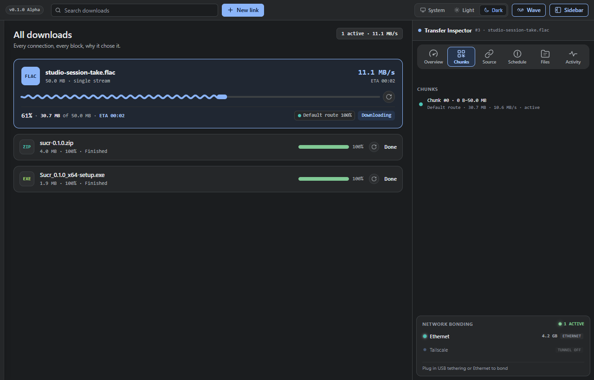
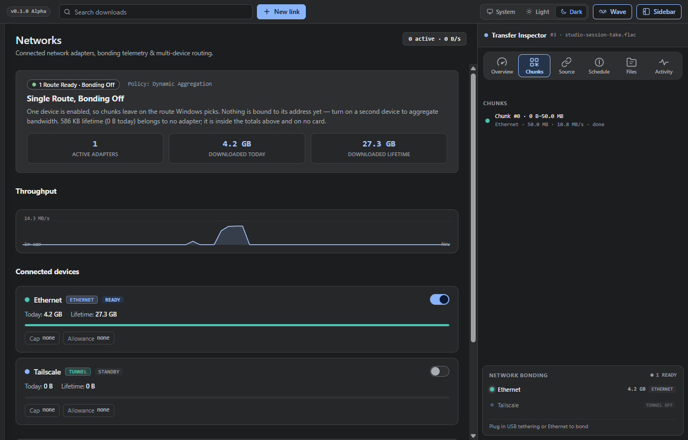
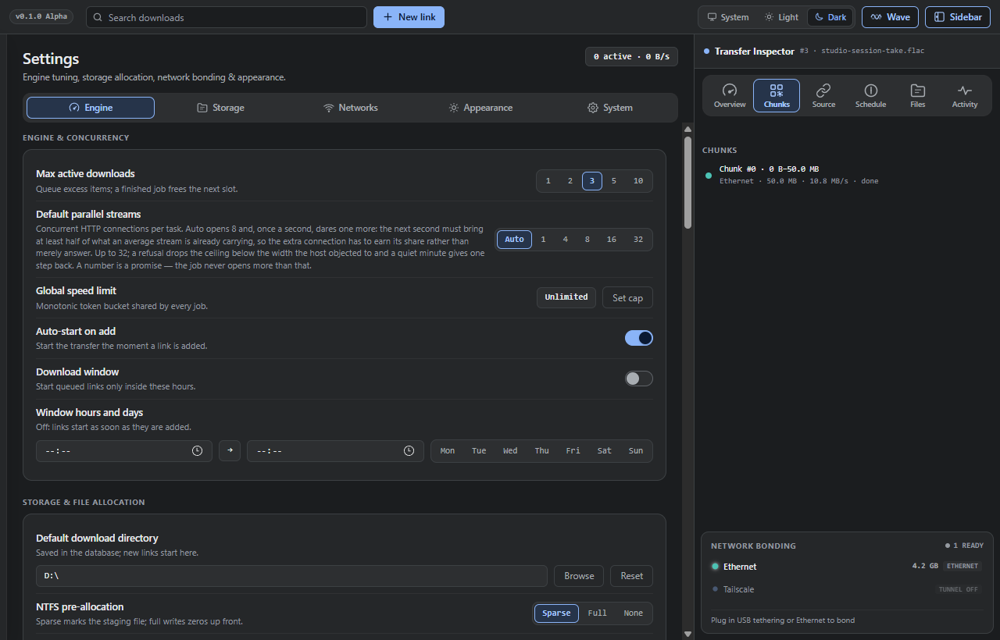
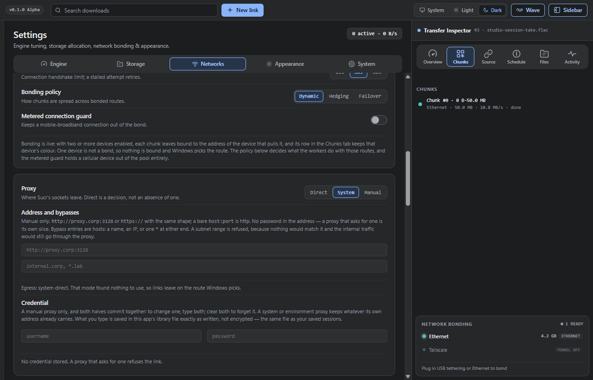
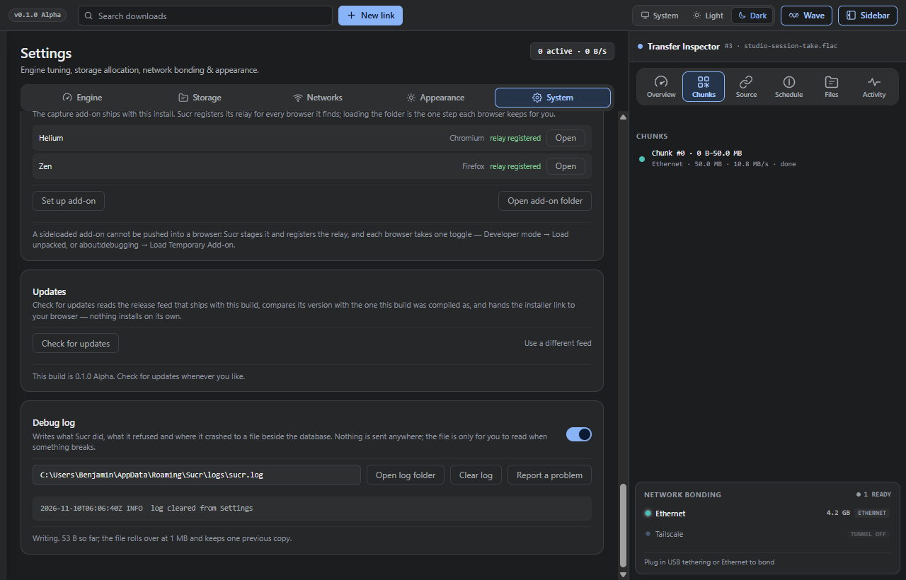
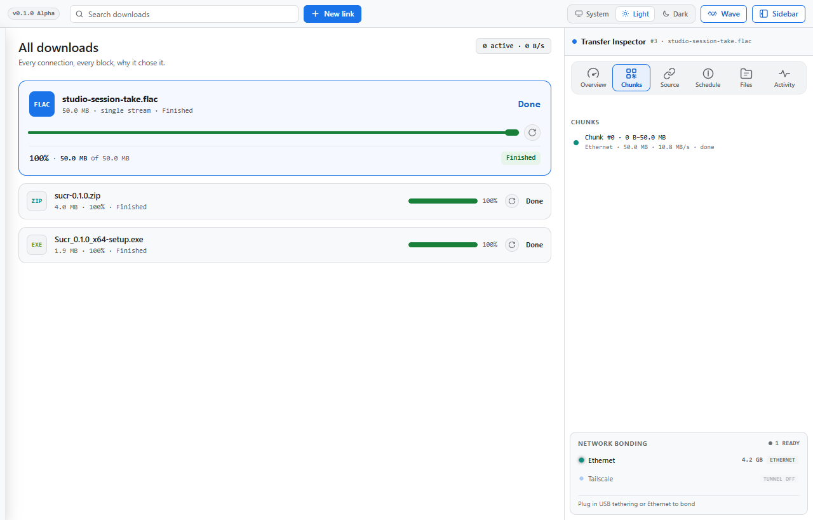

# Sucr

**Sucr 0.1.0 (Alpha)** — a download manager for Windows that shows you the work: every connection, every chunk, and which adapter carried it.

Sucr is a single native executable (Tauri 2 + WebView2, no Electron) of about 4.7 MB. It does not ship a browser engine, a background service, or an installer that runs at boot.

> **Alpha.** This is the first build of the Alpha stage, released as 0.1.0. The feature set can change between releases.



## What it does

- **Multi-connection downloads.** A job starts with 8 concurrent HTTP connections and widens toward 32 only when an extra connection earns its share of the bandwidth. If the host refuses one, the job narrows again instead of stalling.
- **Resuming that checks.** A paused transfer continues only when the remote's ETag, `Last-Modified` and sampled bytes still match what was downloaded.
- **An inspector per download.** Overview, chunks (with the route that carried each block), source, schedule, files and activity.
- **Network control.** Per-adapter speed caps and data allowances, a bonding policy across adapters (dynamic, hedging, failover) and a guard that keeps a metered connection out of the bond.
- **Proxies and credentials.** System, direct or manual proxy with Basic auth and bypasses, plus per-host site credentials for links that need a login.
- **Browser capture.** A Manifest V3 add-on that hands downloads to Sucr — Chromium (Chrome, Edge, Helium) and Firefox (Firefox, Zen).
- **Download window.** Queued links start only inside the hours and days you pick.
- **Updates, debug log and a report button** that opens a pre-filled GitHub issue. Nothing is sent unless you submit it.



## Install

1. Open [Releases](https://github.com/benjaminspoop7-sys/sucr/releases/latest) and download `Sucr_0.1.0_x64-setup.exe`.
2. Run it. It installs per-user (no administrator prompt) into `%LOCALAPPDATA%\Sucr`.
3. The build is unsigned, so Windows SmartScreen will warn you: **More info → Run anyway**.

Requirements: Windows 10 or 11, x64. The app uses the WebView2 runtime, which Windows 11 and current Windows 10 builds already include.

Progress is checked against the release feed compiled into the build. Settings → System → **Check for updates** compares your version with the newest published release and opens the installer link in your browser; it never installs anything by itself.

## Browser add-on

The installer ships the add-on under `%LOCALAPPDATA%\Sucr\addon`. Both browsers ask for a one-time confirmation to load it:

1. Launch Sucr once, so it registers the native-messaging host.
2. Settings → System → **Browser add-on** lists the browsers Sucr found. **Set up add-on** copies the bundled add-on to `%APPDATA%\Sucr\addon` and registers the relay; **Open add-on folder** opens that copy. Each browser also has an **Open** button that takes you to its own add-on page.
3. Chromium: Developer mode → **Load unpacked** → `addon\chrome`.
   Firefox: **Load Temporary Add-on** → `addon\firefox\manifest.json`.

With capture on, a browser download is handed to Sucr before it starts. Hold <kbd>Alt</kbd> over a link or a video to grab it directly; pasted links also work. On YouTube every format in the ladder takes as one merged file — video and audio are fetched separately and muxed by Sucr's own MP4/WebM muxer.

## Settings







Everything is stored locally in one SQLite file, `%APPDATA%\Sucr\sucr.db`. There is no account and no sync.

## Two themes



## Build from source

Prerequisites: a current Node.js LTS, a Rust toolchain, and the WebView2 runtime that ships with Windows.

```sh
cd app
npm install
npm run build        # renders src/renderer and builds src-tauri into a release exe
npm run typecheck
```

For the installer:

```sh
cd app
PATH="/path/to/cargo/bin:$PATH" ./node_modules/.bin/tauri build --bundles nsis
```

`npm run build` locates the real `cargo` through `CARGO_HOME` (falling back to `~/.cargo`) because the Tauri CLI cannot spawn a POSIX `cargo` shim.

The add-on has its own build:

```sh
cd extension
./build.sh           # writes dist/chrome and dist/firefox
```

## Repository layout

| Path | What it is |
| --- | --- |
| `app/` | The application: `src/renderer` (UI), `src-tauri/src` (engine, SQLite, IPC), `src/shared` (models and the IPC contract) |
| `extension/` | The browser add-on, Chromium and Firefox manifests |
| `design/` | Design notes and measured records for each shipped slice |
| `branding/` | App icon sources |
| `docs/screenshots/` | The images in this README |

## License

Sucr is released under the MIT License. See [LICENSE](LICENSE) for the full text.
