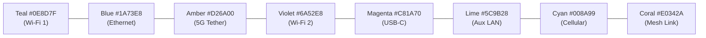
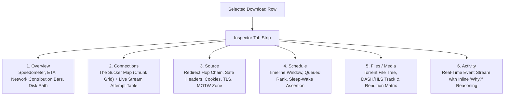
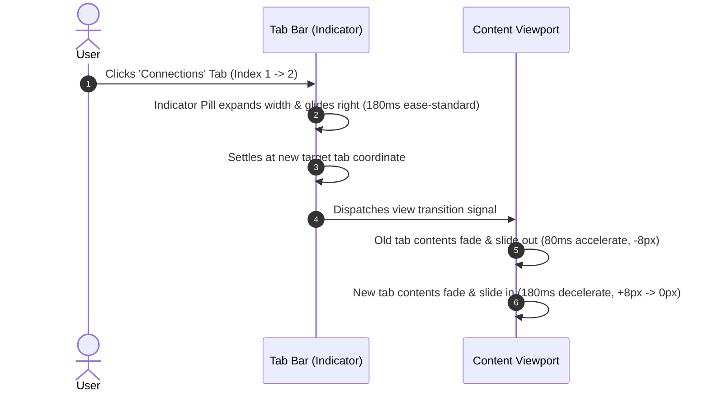
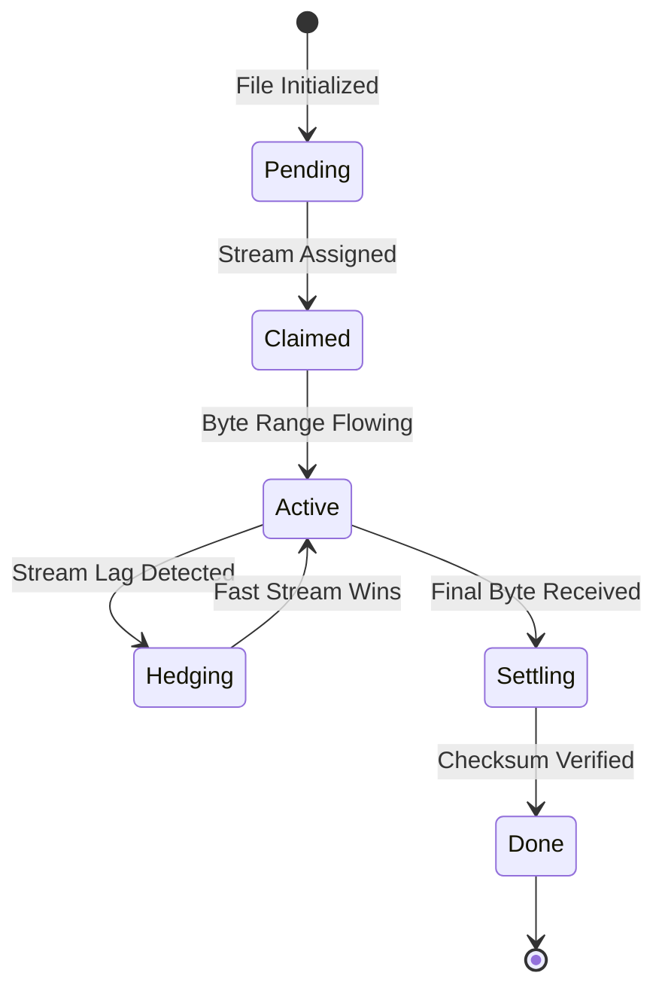

# Sucr — Art & Motion Design Specification

> **Positioning:** *The download manager that shows you the work — every connection, every block, every network, and why it made the choice it just made.*

---

## 1. Executive Summary & Brand Identity

Derived from the comprehensive reverse-engineering and architectural synthesis of **Plexo** (multi-network bonded streaming engine) and **XDM** (DASH/HLS transmuxing and single-window efficiency), **Sucr** combines blistering download acceleration with an honest, transparent visual surface.


### The Core Metaphor
- **Name:** **Sucr** (derived from the suckers on an octopus tentacle, representing connection points that latch onto multiple networks and servers simultaneously).
- **Brand Geometry (V18):** Google Material-adjacent clean curves, pure flat planes, precision geometric suction nodes, and friendly intelligence. No scary tentacles, no sharp dark-pattern spikes, and no neon glow effects.

---

## 2. Visual Design System

Sucr rejects tacky blurred glows, heavy drop shadows, and rainbow gradients. In their place is a **scientific, telemetry-first design language** built on crisp `0.5px` hairlines, tabular typography, and calibrated WCAG 2.1 AA luminance ratios.

### 2.1 Color Tokens & Theming

Sucr supports three dynamic theme states: **System**, **Light**, and **Dark**.

| Token Role | Light Surface (`#FFFFFF`) | Dark Surface (`#1B1D1F`) | Contrast & Purpose |
|:---|:---|:---|:---|
| **Base Accent** | `#1A73E8` | `#8AB4F8` | Primary active states, focus rings, selected items |
| **Accent Ink** | `#1765CC` | `#A6C8FF` | High-legibility text on accent tints |
| **Accent Tint** | `#E8F0FE` | `#26344A` | Selected row backgrounds, active tab pills |
| **Surface 1** | `#F8F9FA` | `#252729` | Navigation rails, toolbars, inspector backgrounds |
| **Surface 2** | `#F1F3F4` | `#2D2F31` | Nested cards, data chips, input fields |
| **Border / Divider** | `#DADCE0` (`0.5px`) | `#3C4043` (`0.5px`) | Hairline structure dividers |
| **Success** | `#188038` / `#E6F4EA` | `#81C995` / `#10331C` | Verified integrity, completed chunks |
| **Warning / Stall**| `#B63A0A` / `#FEF7E0` | `#FDD663` / `#302A01` | Slow connection fallback, disk backpressure |
| **Danger / Failed** | `#D93025` / `#FCE8E6` | `#F28B82` / `#3C1F1E` | Checksum mismatch, refused connections |

### 2.2 Network Attribution Palette
To cleanly visualize per-NIC bonding (e.g. Wi-Fi + 5G USB Tethering + Ethernet), Sucr allocates eight distinct semantic fill hues:



### 2.3 Typography & Grid Hierarchy
- **UI & Control Labels:** `Inter` (weights `400`, `500`, `600`). Crisp and unobtrusive.
- **Numbers, Telemetry & Rates:** `Roboto Mono` with `font-variant-numeric: tabular-nums`. Eliminates jitter during high-speed multi-megabyte transfers.
- **Hairlines:** The signature `0.5px` border creates a precision instrument aesthetic reminiscent of high-end developer tooling.

---

## 3. Screen Architecture & Tab Navigation

Unlike the dialog-heavy surfaces of legacy download managers or XDM's multi-window sprawl, Sucr uses a **unified 3-pane responsive desktop shell** that preserves context at all times:

```
┌──────────────────────────────────────────────────────────────────────────┐
│ Titlebar (44px)   [🐙 Sucr]               [ ⌘K Search... ]        [— □ ✕] │
├────────────┬─────────────────────────────────────────────┬───────────────┤
│ Left Rail  │ Central List Canvas                         │ Inspector     │
│ (248px)    │ (Virtualized, dynamic density)              │ (392px)       │
│            ├─────────────────────────────────────────────┤               │
│ • Library  │ [Toolbar: + New Link  ⏸ Pause  ⋯ ]         │ [Tab Strip]   │
│ • Queues   │                                             │ Overview      │
│ • Networks │   Row 1: ISO Image · 4.8 GB · 42.1 MB/s     │ Connections   │
│ • Media    │   Row 2: DASH Stream · 1.2 GB · 18.4 MB/s   │ Source        │
│ • Grabber  │   Row 3: Release.tar.zst · Completed        │ Schedule      │
│ • History  │                                             │ Files         │
│            │                                             │ Activity      │
├────────────┴─────────────────────────────────────────────┴───────────────┤
│ Statusbar (32px)  128 GB free · 3 active · ▣ Schedule on · ◐ 60.5 MB/s · ☾│
└──────────────────────────────────────────────────────────────────────────┘
```

### 3.1 Responsive Breakpoints & Overlay Drawer Mode
- **Standard Desktop (≥ 1180px):** Three persistent columns (Rail 248px, List flexible, Inspector 392px).
- **Responsive Drawer (< 1180px):** The Inspector switches from a static column to an **interactive slide-out Overlay Drawer**:
  - The central list reclaims full horizontal width.
  - Clicking any download row or pressing `⌥3` smoothly slides the drawer in from the right edge (`translateX(100% → 0%)`).
  - An ambient backdrop scrim (`rgba(0,0,0,0.18)` light / `rgba(0,0,0,0.42)` dark) fades in (`opacity: 0 → 1` over `200ms`).
  - Dismissable via keyboard `Esc`, swipe gesture to the right, clicking the backdrop, or clicking the floating close pill.
- **Ultra-compact (< 900px):** The left rail automatically collapses into a 56px icon rail.


---

## 4. How the Tabs Work Across the App

Tabs in Sucr exist across two primary tiers: **Inspector Context Tabs** (inspecting a selected download) and **Settings Tabs** (global configuration).

### 4.1 Inspector Tabs (Context Detail)

When an item is clicked in the library list, the right-hand Inspector pane (`392px`) populates with six dedicated analytical tabs:



#### Detailed Tab Breakdown:
1. **Overview:** Big tabular percentage (`40px`), real-time aggregate speed sparkline, per-network share breakdown bars, and destination folder chips.
2. **Connections (The Sucker Map):** The visual centerpiece showing every block range, which network downloaded it, and active hedged races.
3. **Source:** Full HTTP request anatomy, server ETag, TLS cipher, proxy route, and Mark-of-the-Web provenance preview (`Zone.Identifier`).
4. **Schedule:** Per-download start/stop boundaries mapped against the global schedule window, with wake-timer capability status.
5. **Files / Media:** For multi-file torrents or video captures (DASH adaptation sets, audio language pairs, video resolutions).
6. **Activity ("The Why Trail"):** Transparent diagnostic log explaining automatic engine decisions (e.g., *"Hedged stream #4 on Ethernet because Wi-Fi slowed <10% median"*).

### 4.2 Settings Tabs (Global Policy)
A dedicated, keyboard-accessible preferences window with instant search:
- **General:** Login autostart, notifications (with OS Focus Assist detection), update channels.
- **Downloads:** Default paths, collision policies, sparse file preallocation, Mark-of-the-Web default.
- **Browser Integration:** Extension bridge status (ports 19300–19307), filetype exclusions, force/prevent hotkeys.
- **Network:** Proxy profiles (PAC, SOCKS5, HTTP), DoH resolvers, per-server stream ceilings.
- **Limits & Schedule:** Single shared token-bucket speed limiter, night schedule rules, wake timers.
- **Appearance:** Theme toggle (System/Light/Dark), 8 accent swatches, row density (Comfortable/Compact).
- **Advanced:** SQLite database health, WAL compaction, credential keyring integrity, diagnostic bundle export.

---

## 5. Animation System & Motion Choreography

### 5.1 The Governing Law: "Motion is Telemetry"
> **Every animation must report genuine background work or confirm an intentional user state change.** Decorative spring physics, continuous pulsing blurs, and vanity entrance staggers are explicitly banned.

### 5.2 Motion Tokens & Curves

```
--dur-1:   80ms   (Press feedback, instant toggles)
--dur-2:  120ms   (Hover, focus rings, chip activations)
--dur-3:  180ms   (Tab transitions, status swaps)
--dur-4:  220ms   (Menus, popovers, inspector drawer slide-in)
--dur-5:  260ms   (Sheets, modal entries)
--dur-6:  400ms   (Completion checkmark draw, major view swaps)

--ease-standard:   cubic-bezier(0.20, 0.00, 0.00, 1.00)  [State changes]
--ease-decelerate: cubic-bezier(0.05, 0.70, 0.10, 1.00)  [Entering elements]
--ease-accelerate: cubic-bezier(0.30, 0.00, 0.80, 0.15)  [Exiting elements]
--ease-linear:     linear                                 [Telemetry & stream flows]
```

### 5.3 Tab Motion Across the Strip

The inspector tab strip uses a **coordinated two-component animation**:



1. **The Floating Indicator (Active Pill):**
   - A soft rounded background pill (`--accent-tint`) and active ink label.
   - When switching tabs, the indicator slides continuously across the horizontal axis using CSS transform:
     $$\Delta X = X_{\text{target}} - X_{\text{current}}$$
   - Timing: `180ms` with `--ease-standard`. For wide jumps across multiple tabs, it slightly expands its bounding width by `15%` mid-flight (`stretch-glide`) to convey physical momentum before snapping cleanly to the destination label.
2. **The Content View Cross-Slide:**
   - Directional awareness: Moving from Tab 1 to Tab 2 slides content from right to left (`translateX(10px -> 0px)` + `opacity: 0 -> 1`). Moving from Tab 4 to Tab 2 slides from left to right (`translateX(-10px -> 0px)` + `opacity: 0 -> 1`).
   - Duration: `180ms` with `--ease-decelerate`. Zero layout jump.

### 5.4 Overlay Drawer Choreography & Animated Tab Micro-Interactions

When triggered on viewports `< 1180px` (or on demand via keyboard/toolbar):

#### 1. Drawer Entrance & Scrim
- **Drawer Panel (`drawer-in`):** `translateX(100% → 0%)` over `220ms` using `--ease-decelerate`. Elevation level `2` hairline shadow applied.
- **Backdrop Scrim (`scrim-in`):** `opacity: 0 → 1` over `200ms` with `--ease-standard`.
- **Exit (`drawer-out`):** `translateX(0% → 100%)` over `160ms` using `--ease-accelerate`.

#### 2. Tab Icon Micro-Interactions (Transient Selection Feedback)
Each tab icon is drawn with clean precision vector strokes (`1.8px`) and calibrated directly in SVG `viewBox="0 0 24 24"`. Animations are strictly **transient micro-interactions** (240ms–340ms) triggered on selection, settling immediately into a clean, rock-solid resting state:

| Tab | Icon | Transient Micro-Animation Triggered | Telemetric Purpose |
|:---|:---|:---|:---|
| **Overview** | Speedometer | Gauge needle revs `-35° → +32° → +20°` over `340ms` around pivot `(12, 14)` | Reflects live speed sensing |
| **Map** | Sucker Matrix | Central suction node pulses once (`scale 0.8 → 1.3 → 1.0`) over `260ms` | Confirms chunk lock |
| **Source** | Link / Chain | Left and right links glide together with a tactile magnetic snap over `260ms` | Reflects TLS / HTTP handshake |
| **Schedule** | Clock | Minute hand sweeps smoothly `90°` around exact center `(12, 12)` over `320ms` | Indicates temporal window lock |
| **Files** | Folder / Tree | Folder executes a crisp 2px sheet peek lift over `240ms` (no polygon skewing) | Reflects archive unpack |
| **Activity** | Telemetry Pulse | Single oscilloscope trace sweeps across over `320ms` via `stroke-dashoffset` | Signifies event log capture |

### 5.5 Precision Multi-Network Segmented Telemetry Bar (Replacing the Sine Squiggle)

> [!NOTE]
> **Design Refinement (UX Feedback):** The initial Google Material 3 oscillating sine wave ("Squiggle") was found to introduce cognitive confusion regarding progress accuracy (users questioned whether wave crests represented download spikes or packet loss). Sucr replaces the squiggle with the **Precision Multi-Network Segmented Telemetry Bar**.

- **Multi-NIC Segmented Geometry:** Rather than an undulating curve, the progress bar is an ultra-crisp pill bar ($h = 12\text{px}$ in cards, $14\text{px}$ in hero rows, $8\text{px}$ in tables) cleanly divided into proportional network attribution bands:
  - **Wi-Fi 6:** Teal (`--n1`: `#0E8D7F` light / `#4CC2B4` dark)
  - **Ethernet:** Google/Antigravity Blue (`--n2`: `#1A73E8` light / `#8AB4F8` dark)
  - **5G USB-C:** Warm Amber (`--n3`: `#D26A00` light / `#F0955A` dark)
  - **Hedging Duplication:** Violet (`--n4`: `#6A52E8` light / `#B6A2FF` dark)
- **Active Wire Frontier Shimmer:** To preserve the live feeling of data motion without geometric distortion, a subtle, fiber-optic specular light pulse (`active-wire-shimmer`, `2.4s` linear gradient flow at $0.25$ opacity) gently traverses the active segments.
- **Frontier Specular Needle:** A crisp $1\text{px}$ vertical frontier marker at the exact completed boundary ($86.0\%$) with a subtle ambient glow, anchoring visual certainty.
- **State Transition Dynamics:**
  - **Paused / Queued:** Shimmer stops immediately; frontier needle fades to static border color.
  - **Completed:** All segments transition to solid green (`--success`: `#188038` light / `#81C995` dark) with a smooth `180ms` fill transition.
- **Dedicated Theme Segmented Controls:**
  - Placed prominently in the window chrome header: `[ ☀️ Light ] [ 🌙 Dark ]`.
  - Immediate synchronized update across `html[data-theme]`, `body[data-theme]`, `color-scheme: light | dark`, and background canvas, ensuring zero jarring white borders in dark mode.

---

## 6. The Signature Feature: The Sucker Map Animation

The **Sucker Map** is the heart of Sucr's interface. It visualizes the entire file as a virtualized 2D grid of discrete blocks (1–8 MiB chunks):



### 6.1 Cell Anatomy & Real-Time Flow
- **Grid Layout:** Columns automatically compute based on pane width (`8px`, `12px`, or `16px` user-configurable cell sizes).
- **Multi-Network Fill (`cell-fill`):** As bytes arrive across multiple bonded adapters, horizontal sub-bands fill within each individual cell using the assigned network colors.
- **Contiguous Frontier Takeover (A1):** When a stream finishes a chunk and immediately absorbs the contiguous next range, the cell boundary widens seamlessly over `150ms linear`, visually depicting disk-locality optimization.
- **Hedging in Motion:** When a slow connection is hedged by a secondary stream, the cell splits into two racing colored bands. When the winner claims the block, the loser band dissolves over `220ms ease-out`.
- **Completion Check (`draw-check`):** When the entire download passes coverage assertion and checksum verification, the hero badge executes a custom SVG path draw-on:
  ```css
  stroke-dasharray: 24;
  stroke-dashoffset: 24;
  animation: drawCheck 320ms var(--ease-decelerate) forwards;
  ```

### 6.2 Automatic Cell Downscaling (> 1,000 Blocks)

To preserve visual legibility without dropping frames or turning large files into an unintelligible scroll-trap, Sucr implements **dynamic multi-tier downscaling**:

```mermaid
flowchart TD
    Init["Download Added"] --> CountCheck{"Total Block Count?"}
    CountCheck -->|1 to 250 blocks| Tier1["Comfort Mode (16px Cells)<br/>Full chunk borders, large attempt dots, 4px gaps"]
    CountCheck -->|251 to 1,000 blocks| Tier2["Standard Mode (12px Cells)<br/>Balanced density, per-network bands, 2px gaps"]
    CountCheck -->|1,001 to 5,000 blocks| Tier3["Dense Texture Mode (8px Cells)<br/>Automated downscale, unified raster grid, 1px gaps"]
    CountCheck -->|> 5,000 blocks (50GB+ files)| Tier4["Heat-Map Micro Mode (4px Cells)<br/>Sub-pixel stream texture, zoom lens on hover"]

    Tier3 --> ZoomAffordance["Zoom Lens Tooltip<br/>Hovering any micro-cell opens a 4x magnified HUD chip"]
    Tier4 --> ZoomAffordance
```

- **Seamless Transition:** When a dynamic block split occurs during transfer, cells interpolate scale over `200ms ease-standard`.
- **Hover Zoom Lens:** In Dense (`8px`) and Micro (`4px`) modes, hovering any block pops up a floating HUD chip showing block index, exact byte range, which network transferred it, and round-trip latency.


---

## 7. Supporting Empty & State Artwork

Sucr includes clean, custom vector illustrations for edge states:

```carousel

<!-- slide -->

<!-- slide -->

<!-- slide -->

<!-- slide -->

<!-- slide -->

```

---

## 8. Accessibility & Reduced Motion Modes

To guarantee universal access without compromising the telemetry-first vision:
1. **Full Motion Mode:** Ambient NIC flow loops, live block fill interpolation, directional tab slides, and completion check draws.
2. **Reduced Motion Mode:** entered by either trigger — the system `prefers-reduced-motion: reduce`, or the app's own **Interface motion** switch set to Reduced. The renderer collapses the two into `html[data-motion]`, and the stylesheet keys on that attribute because a collapsed `!important` duration cannot be undone by a later override. With the switch on Full, everything below runs even while Windows asks for stillness.
   - Ambient stroke loops and border cycles are disabled.
   - Tab switching transitions instantly replace spatial translation with a gentle `80ms` cross-fade.
   - Sucker Map block fill updates jump cleanly at 4 Hz discrete steps instead of continuous linear tweens.
   - Exemption, deliberate: the inspector tab strip's one-shot 180–320 ms glyph nudge stays animated. It is the only signal that the pane changed, it moves a 20 px icon and nothing else on the page.
3. **High Contrast Mode (`prefers-contrast: more`):**
   - Border hairlines automatically elevate from `0.5px` to `1.0px`.
   - Patterned hatching overlays are enforced on all Sucker Map cells so color is never the single carrier of state.


---

## 9. Settings Stage Architecture (5 Pillars)

When navigating to Settings from the system rail, the central download list is replaced with a clean two-column configuration stage: a 200px category sub-nav on the left and stacked Material 3 setting cards on the right.

### Pillar 1: Multi-NIC & Wire Bonding
- **Bonding Policy:** Dynamic Throughput Aggregation (proportional chunk distribution), Tail Hedging (speculative replication on final < 5% or 1500ms stall), Failover Standby.
- **Adapter Whitelist:** Enumerated physical adapters (Realtek 2.5GbE, Intel Wi-Fi 6, USB Cellular NDIS) with enable toggles and priority ranks.
- **Metered Connection Guard:** Never bond onto Windows metered interfaces without per-task user approval.

### Pillar 2: Concurrency & Stream Engine
- **Task Limits:** Max concurrent active downloads (Default: 3).
- **Stream Depth:** Max streams per download (Default: 8, range 1–32); Max streams per adapter (Default: 4).
- **Scheduler & Limits:** Global speed limiter (Unlimited vs custom MB/s); Quiet Hours scheduler profile.

### Pillar 3: Storage & Windows I/O
- **Download Path:** Default target directory with native FolderPicker integration (window.sucr.selectFolder()).
- **File Preallocation:** FSCTL_SET_SPARSE (instant allocation, zero wear) vs Contiguous/Fallocate.
- **Flush Cadence:** In-memory block buffer (Default: 16 MiB) and SQLite WAL flush cadence (150ms).
- **Security & Integrity:** NTFS Mark-of-the-Web (Zone.Identifier ZoneId=3) stream writer; Automatic post-completion hash verification (SHA-256 / SHA-1 / MD5).

### Pillar 4: Browser Integration & Grabber
- **Clipboard Watcher:** Auto-detect downloadable binaries (.iso, .zip, .exe, .bin, .tar.gz, .mkv) with configurable size floor (> 10 MB).
- **Native Messaging Bridge:** Host installer for Chrome, Edge, Brave, and Firefox extensions.

### Pillar 5: Appearance, Audio & Behavior
- **Theme:** Segmented control [ System | Light | Dark ] with 200ms smooth cross-fade.
- **Telemetry Bar Style:** [ Segmented Telemetry (Default) | M3 Squiggle Wave ].
- **Motion Calibration:** Segmented control [ System | Full (Default) | Reduced ]. Full is the install default, because most Windows profiles report `prefers-reduced-motion` and following it would ship a still app; System follows `prefers-reduced-motion`; Full and Reduced are Sucr's own call and outrank it. The row's helper line states which way System currently resolves, so the setting is never a mystery.
- **Audio Chime:** Subtle acoustic confirmation tick upon 100% hash verification.
- **Close Behavior:** Minimize to System Tray vs Exit Application.
