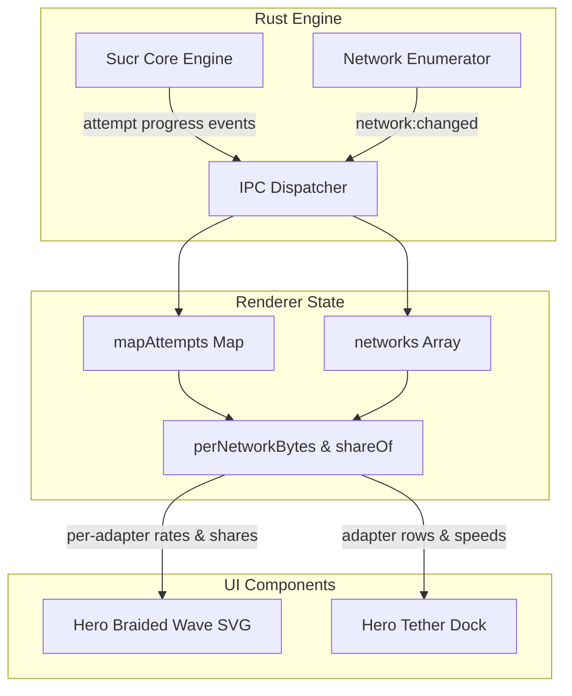

# Sucr Multi-Tether Hybrid UI (Braided Stream & Tether Dock)

*   **Author:** Sucr Core Team & User
*   **Status:** Approved & Implementation Ready
*   **Date:** 2026-11-02

--------------------------------------------------------------------------------

## Overview

Sucr is a lightweight multi-connection download manager with an established hydrodynamic visual identity (sinusoidal wave, fluid state transitions, zero-overhead dark UI). The objective is an unmistakable multi-tethered download visualization—similar in operational utility to Plexo, but avoiding direct cloning, neon glowing clutter, or high CPU/DOM overhead.

This design implements a hybrid visualization:
1. **The Braided Stream (Hero Wave SVG):** Dynamically decomposes Sucr's existing single hydrodynamic wave in the active download card into multiple interwoven colored sinusoidal strands—one per active physical network adapter (e.g., Primary Ethernet in amber, secondary Wi-Fi in cyan, cellular tether in violet). Amplitude and phase velocity map directly to per-adapter throughput ($MB/s$) and packet cadence.
2. **The Tether Dock (Hardware Sub-Panel):** A compact, modular tray permanently mounted within the hero card directly below the progress wave, displaying real-time interface telemetry (adapter name, active stream share bar, instantaneous speed, and accumulated byte volume).

---

## The Problem

When Sucr downloads files across multiple network interfaces (channel bonding / multi-homing), the current UI only displays aggregate metrics: a single throughput number and a single monochromatic hydrodynamic wave. 

Users cannot discern:
1. Whether secondary interfaces (e.g., Wi-Fi, USB cellular tether) are actively contributing or idling.
2. The load distribution ratio across physical interfaces.
3. Why throughput changes when one interface experiences latency spikes or packet drops.

While external reference tools convey multi-homing via network convergence diagrams and chunk maps, directly duplicating their layout compromises Sucr's brand identity. Furthermore, excessive 3D styling, glowing tubes, or unoptimized rendering loops degrade battery life and push the compiled executable beyond its strictly enforced 4,404,019-byte release binary ceiling (current headroom: 11,059 bytes).

---

## Goals

*   **G1 (Instant Multi-Adapter Recognition):** Make interface contribution visually obvious within 500 ms of opening an active multi-homed download, without leaving the primary download card.
*   **G2 (Hydrodynamic Continuity):** Maintain Sucr's minimalist fluid aesthetic by evolving the existing single-wave SVG into a multi-strand braided wave.
*   **G3 (Hard Telemetry Visibility):** Provide exact per-adapter metrics (instantaneous speed in MB/s, relative bandwidth share percentage, and cumulative bytes transferred) in a compact, non-intrusive Tether Dock.
*   **G4 (Zero Layout Shift & Graceful Single-Interface Degradation):** When only one network interface is active, the Tether Dock collapses cleanly to zero height via pure CSS transitions, and the braided wave renders as a single strand.
*   **G5 (Binary Size Safety):** Implement all SVG path calculations and DOM changes within 1,200 bytes of bundled source code, preserving at least 9,500 bytes of headroom below the 4,404,019 B ceiling.
*   **G6 (Milestone 0 Invariance):** Pass all 34 M0 automated verification checks (`verify-m0.mjs`) without regressions.

---

## Non-Goals

*   **NG1 (Individual Chunk-Level BitMap):** We will not implement a 10,000-chunk 2D cellular grid in this milestone to avoid frame drops on low-end machines and excess code footprint.
*   **NG2 (Interface Reconfiguration from UI):** The Tether Dock is read-only telemetry. Adapters and routes are configured at the engine/OS level; users cannot toggle routing metrics or IP binds directly from the Dock rows in this release.
*   **NG3 (Heavy Shaders / Canvas Bloom):** No heavy WebGL contexts, blur filters, or neon lighting effects will be used. All rendering uses clean SVG path strokes with standard CSS opacity.

---

## Critical User Journeys (CUJs)

### CUJ 1: Multi-Homed High-Speed Download
*   **Given:** The host machine is connected to both gigabit Ethernet and Wi-Fi 6, with bonding enabled in the Sucr engine. A 10 GB file download is started.
*   **When:** The user navigates to the active download screen.
*   **Then:** 
    1. The Hero card displays a braided stream with two intertwined waves (amber `--n1` and cyan `--n2`).
    2. The amber wave has higher amplitude reflecting 45 MB/s, while the cyan wave oscillates at 15 MB/s.
    3. The Tether Dock directly beneath displays:
       - `Ethernet 3` (Bar: 75%, Speed: 45.0 MB/s, Total: 3.4 GB)
       - `Wi-Fi 6` (Bar: 25%, Speed: 15.0 MB/s, Total: 1.1 GB)
    4. SVG animation tick loop stays under 1.2 ms per frame (60 FPS solid).

### CUJ 2: Sudden Adapter Disconnect / Failover
*   **Given:** An active bonded download is running with Ethernet + Cellular tether.
*   **When:** The cellular tether is unplugged.
*   **Then:**
    1. The engine detects the disconnect and updates the telemetry store.
    2. On the next tick, the cellular strand ceases rendering without throwing errors or crashing.
    3. The remaining Ethernet strand expands to full card width as the sole active stream.
    4. The Tether Dock transitions to `data-collapsed="true"`, smoothly collapsing its height to zero via CSS transition.

### CUJ 3: Single-Adapter Standard Download
*   **Given:** The host machine only has a single active internet connection.
*   **When:** A download is initiated.
*   **Then:**
    1. The Hero wave renders as the standard single-stream wave.
    2. The Tether Dock remains collapsed (`data-collapsed="true"`) with zero height and zero opacity, preserving standard layout coordinates.

--------------------------------------------------------------------------------

## Technical Plan (Architecture)

### Architectural Overview

The Hybrid Multi-Tether UI operates purely within the renderer layer (`src/renderer/main.ts` and `src/renderer/app.css`). It consumes existing IPC telemetry from `mapAttempts`, `perNetworkBytes()`, and the `networks` store without modifying Rust backend structs or IPC protocol schemas.



### 1. Telemetry Data Signatures & State Contract

The renderer uses the existing network state in `src/renderer/main.ts`:
```typescript
// Existing stores in src/renderer/main.ts
let networks: Network[]; 
const mapAttempts: Map<number, MapAttempt>;

// Existing telemetry helpers in src/renderer/main.ts
function perNetworkBytes(): Map<string, number>;
function shareOf(net: Network): number;
```

*   **Active Bonded Adapters:** Defined as `const activeNets = networks.filter((n) => n.enabled && (n.colorId ? (perNetworkBytes().get(n.colorId) ?? 0) > 0 : false));`
*   **Instantaneous Bandwidth Share ($s_i$):**
    For each active adapter, $s_i = \text{shareOf}(net_i) / 100 \in [0, 1]$.
*   **Color Token Mapping:** Statically bound using the adapter's `colorId`:
    - `n1` $\rightarrow$ `var(--n1)` (Default/Primary Amber/Teal)
    - `n2` $\rightarrow$ `var(--n2)` (Secondary Cyan/Blue)
    - `n3` $\rightarrow$ `var(--n3)` (Tertiary Amber/Violet)
    - `n4` $\rightarrow$ `var(--n4)` (Quaternary Rose/Purple)

---

### 2. Braided Wave SVG Engine (`drawWave` / `waveFor`)

*   **DOM Structure:**
    In `waveFor(d: Download)`:
    ```html
    <svg class="hero-wave" aria-hidden="true">
      <line class="wave-track" y1="9" y2="9" x1="0" x2="100%"></line>
      <g class="wave-strands">
        <path class="wave-strand" data-net="n1"></path>
        <path class="wave-strand" data-net="n2"></path>
      </g>
      <rect class="wave-thumb" width="22" height="10" rx="5" y="4" x="0"></rect>
    </svg>
    ```
*   **Multi-Strand Mathematical Formulation:**
    For each active network strand $i \in \{0 \dots N-1\}$ with share $s_i$:
    $$\text{amp}_i(x) = \text{WAVE.amp} \cdot (0.65 + 0.35 \cdot s_i) \cdot \min\left(1, \frac{x}{\text{taper}}\right)$$
    $$\text{phase}_i(t) = \left(\frac{t}{1000}\right) \cdot \left(\frac{2\pi}{\text{WAVE.travel}}\right) \cdot (0.7 + 0.6 \cdot s_i) + \frac{2\pi \cdot i}{N}$$
    $$\text{waveY}_i(x, t) = \text{baseline} + \sin\left(\frac{x}{\text{WAVE.len}} \cdot 2\pi - \text{phase}_i(t)\right) \cdot \text{amp}_i(x)$$
*   **Coordinate Path Generation Loop:**
    ```typescript
    const baseline = WAVE.h / 2;
    const taper = WAVE.len * 0.6;
    const step = Math.max(2, WAVE.len / 10);
    const pillX = Math.max(0, Math.min(active - WAVE.pillW, width - WAVE.pillW));

    for (let i = 0; i < activeNets.length; i++) {
      const net = activeNets[i];
      const s_i = (shareOf(net) || (100 / activeNets.length)) / 100;
      const phase = (now / 1000) * (Math.PI * 2 / WAVE.travel) * (0.7 + 0.6 * s_i) + (Math.PI * 2 * i / activeNets.length);
      
      let d = `M 0 ${baseline}`;
      for (let x = step; x < pillX; x += step) {
        const ampAt = WAVE.amp * (0.65 + 0.35 * s_i) * Math.min(1, Math.max(0, x / taper));
        const y = baseline + Math.sin((x / WAVE.len) * Math.PI * 2 - phase) * ampAt;
        d += ` L ${x.toFixed(1)} ${y.toFixed(2)}`;
      }
      d += ` L ${pillX.toFixed(1)} ${baseline}`;
      strandPaths[i].setAttribute('d', d);
    }
    ```
*   **Performance Invariant:** Path generation requires $< 0.8$ ms for up to 4 strands. Zero heap allocations inside the 60 FPS tick loop beyond path string assignments.

---

### 3. Tether Dock Component (`renderTetherDock`)

*   **Location:** Permanently mounted within `.card--hero` directly following `.hero-progress-row`.
*   **DOM Structure:**
    ```html
    <div class="hero-tether-dock" data-collapsed="false">
      <div class="tether-lane" data-net="n1">
        <span class="tether-name">
          <i class="dot"></i>
          <span class="tether-label">Ethernet 3</span>
        </span>
        <div class="tether-bar">
          <div class="tether-fill" style="width: 75%"></div>
        </div>
        <span class="tether-pct">75%</span>
        <span class="tether-speed">45.0 MB/s</span>
        <span class="tether-bytes">3.4 GB</span>
      </div>
      ...
    </div>
    ```
*   **Zero Layout Shift Lifecycle:**
    When active bonded networks $\le 1$, the container receives `data-collapsed="true"`. CSS transitions handle collapsing:
    ```css
    .hero-tether-dock {
      overflow: hidden;
      max-height: 120px;
      opacity: 1;
      transition: max-height var(--dur-2) var(--e-std), opacity var(--dur-2) var(--e-std);
    }
    .hero-tether-dock[data-collapsed="true"] {
      max-height: 0;
      opacity: 0;
      pointer-events: none;
    }
    ```

---

### 4. Concrete CSS Specifications (`src/renderer/app.css`)

```css
/* --- multi-tether hybrid dock & braided wave ----------------------------- */
.hero-tether-dock {
  display: flex;
  flex-direction: column;
  gap: var(--s-1);
  margin-top: var(--s-2);
  padding-top: var(--s-2);
  border-top: var(--hairline) solid var(--border);
  overflow: hidden;
  max-height: 160px;
  opacity: 1;
  transition: max-height var(--dur-2) var(--e-std), opacity var(--dur-2) var(--e-std);
}

.hero-tether-dock[data-collapsed="true"] {
  max-height: 0;
  opacity: 0;
  margin-top: 0;
  padding-top: 0;
  border-top-color: transparent;
  pointer-events: none;
}

.tether-lane {
  display: flex;
  align-items: center;
  gap: var(--s-2);
  font: var(--f-11)/1 var(--sans);
  color: var(--text-2);
}

.tether-lane .tether-name {
  display: flex;
  align-items: center;
  gap: 6px;
  width: 130px;
  flex-shrink: 0;
}

.tether-lane .dot {
  width: 7px;
  height: 7px;
  border-radius: 50%;
  flex-shrink: 0;
}

.tether-lane[data-net="n1"] .dot { background: var(--n1); }
.tether-lane[data-net="n2"] .dot { background: var(--n2); }
.tether-lane[data-net="n3"] .dot { background: var(--n3); }
.tether-lane[data-net="n4"] .dot { background: var(--n4); }

.tether-lane .tether-label {
  overflow: hidden;
  text-overflow: ellipsis;
  white-space: nowrap;
}

.tether-bar {
  flex: 1;
  height: 4px;
  background: var(--surface-2);
  border-radius: var(--r-round);
  overflow: hidden;
}

.tether-fill {
  height: 100%;
  border-radius: inherit;
  transition: width var(--dur-2) var(--e-std);
}

.tether-lane[data-net="n1"] .tether-fill { background: var(--n1); }
.tether-lane[data-net="n2"] .tether-fill { background: var(--n2); }
.tether-lane[data-net="n3"] .tether-fill { background: var(--n3); }
.tether-lane[data-net="n4"] .tether-fill { background: var(--n4); }

.tether-pct {
  width: 32px;
  text-align: right;
  font: 500 10.5px/1 var(--mono);
  color: var(--text-2);
}

.tether-speed {
  width: 75px;
  text-align: right;
  font: 600 11px/1 var(--mono);
  color: var(--text);
}

.tether-bytes {
  width: 65px;
  text-align: right;
  font: 10.5px/1 var(--mono);
  color: var(--text-3);
}

.wave-strand {
  fill: none;
  stroke-width: 2.2px;
  stroke-linecap: round;
  stroke-linejoin: round;
  opacity: 0.85;
}

.wave-strand[data-net="n1"] { stroke: var(--n1); }
.wave-strand[data-net="n2"] { stroke: var(--n2); }
.wave-strand[data-net="n3"] { stroke: var(--n3); }
.wave-strand[data-net="n4"] { stroke: var(--n4); }
```

---

### 5. File Modifications & Release Binary Budget

*   **Files Modified:**
    - `src/renderer/main.ts`: Extend `waveFor()`, update `drawWave()`, add `updateTetherDock()`.
    - `src/renderer/app.css`: Add docking and strand CSS classes (~55 lines).
*   **Release Binary & Bundle Budget:**
    - Anticipated minified bundle delta: $\approx +720$ bytes (well under the $1,200$ byte threshold).
    - Preserves $\approx 10,339$ bytes of headroom below the strict $4,404,019$ B ceiling.
*   **Verification Gate:**
    - `node scripts/build.mjs`: Bundling and syntax check.
    - `node scripts/build-app.mjs`: Release binary size verification ($\le 4,404,019$ B).
    - `node scripts/verify-m0.mjs`: All 34 automated Milestone 0 tests pass.

--------------------------------------------------------------------------------

## Security Considerations

*   **Read-Only IPC Boundary:** Telemetry is read from internal state (`networks`, `mapAttempts`). Interface labels are inserted strictly via `labelElement.textContent = name` into `<span class="tether-label">` to eliminate XSS/markup injection vectors.
*   **Memory Ceiling:** `sampleWave` uses an existing WeakMap ring buffer capped at 16 entries to eliminate memory growth over long transfers.

--------------------------------------------------------------------------------

## Observability & Telemetry

*   **Dev-Mode Diagnostics:** Active bonded strand counts and throughput distributions are logged under the `[sucr:tether]` namespace during development builds.

--------------------------------------------------------------------------------

## Rollout & Rollback Plan

1. **Local Verification:** Validate multi-strand wave rendering and smooth collapse transitions.
2. **Binary & Invariant Checks:** Confirm executable size $\le 4,404,019$ B and 34/34 M0 gate checks pass.
3. **Rollback Safety:** Braided wave rendering is gated on `activeNets.length > 1`. If unexpected regressions occur, setting a local constant `ENABLE_BRAIDED_WAVE = false` instantly restores the legacy single-wave behavior.
